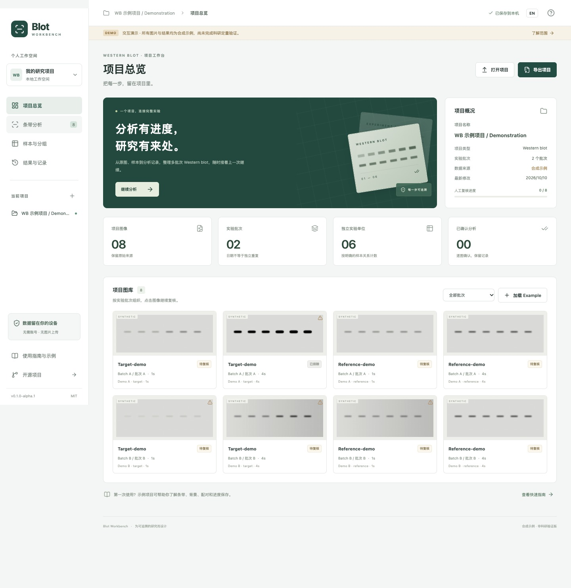

# Blot Workbench / 印迹工作台

> **首版范围 / First-edition scope (2026-10-20):** 保留可选注册、登录和本地项目保存；不开放实验数据上传或云同步。跨电脑请导出、导入项目文件。Optional accounts and local projects are available; experimental-data uploads and cloud sync are disabled. Transfer projects between computers using exported project files.

[中英首页 / Bilingual home](README.md) · [Live demo](https://gaoyuan-0423.github.io/blot-workbench/) · [User guide](docs/user-guide.en.md) · [Vision API guide](https://github.com/Gaoyuan-0423/blot-workbench/blob/codex/configurable-vision-api/docs/vision-api.en.md) · [Issues](https://github.com/Gaoyuan-0423/blot-workbench/issues)

A Western blot project workbench for laboratories. The first step is to make image organization, sample relationships, review, and returning to unfinished work easier, before validating experimental-image quantification.

## Workspaces and boundaries

- [Single-strip recognition](https://gaoyuan-0423.github.io/blot-workbench/?mode=single): import a cropped 8-bit PNG/JPEG strip, review automatic regions, and view relative intensities alongside the image.
- [Multiple rows and reference](https://gaoyuan-0423.github.io/blot-workbench/?mode=quick): choose a target row and reference row or independent reference image.
- [Full WB analysis](https://gaoyuan-0423.github.io/blot-workbench/#real): original TIFF/PNG, precise ROIs, background correction, paired statistics, and figure export.
- [Synthetic project demo](https://gaoyuan-0423.github.io/blot-workbench/#demo): the legacy workflow with fixed example values.

The indigo interface links to the pathology and PCR workbenches. See the [2026-10-16 update](docs/releases/ui-refresh-2026-10-16.md). Archived releases remain available in [Releases](https://github.com/Gaoyuan-0423/blot-workbench/releases). Pages deploys the exact build artifact from successful main-branch CI.

**Pixel-based workspaces remain experimental, with bounded format support and incomplete scientific validation on experimental images. Review automatic ROIs. Export single-strip and quick-analysis results before refreshing; the full workspace has separate local storage and archives.**

Start real analysis at `http://127.0.0.1:4318/#real`: import → check file metadata → describe lanes once → batch proposals → manual review → plots, CSV, and archive. Read the [real-image guide](docs/real-images.en.md) ([中文](docs/real-images.md)) and [validation scope](docs/validation-real-images.md).

Public [synthetic pixel validation example](public/examples/real/README.md): original images, an actual-pixel project archive, and analytically specified results. Only synthetic data are included in website examples, published screenshots, and public fixtures. Private images, results, and projects are never bundled, preloaded, or published.



The historical screenshot shows the synthetic project demonstration. See the [screenshot record](docs/screenshots/README.md) for version and environment evidence; a screenshot does not establish algorithm accuracy or cross-platform compatibility.

Testing is off by default. When explicitly enabled for a confirmed two-condition paired design, it uses original target/reference ratios, so changing a valid plot baseline cannot change the P-value for the same eligible pairs. A common baseline preserves between-control variation but does not establish cross-membrane or cross-batch comparability. See [statistical methods and limits](docs/paired-statistics.md).

## What you can explore

- Organize dates, batches, membranes, target/reference images, and exposures within one project. A project is not a single experiment.
- Inspect samples, groups, and experimental units without treating image count as independent sample count.
- Review band/background ROIs, reference pairing, and exclusions; see how changes invalidate existing illustrative results.
- Reuse templates while preserving analysis-time snapshots and revisions.
- Inspect preset background correction and normalization, export projects/CSV, and resume saved work.
- Switch between Chinese and English. In the development version, configure a vision service and explicitly test it with the built-in synthetic image.

The demonstration contains **8 synthetic images, 2 batches, a target and reference at 2 exposures, and the same 6 samples representing 6 experimental units across batches**. Repeated exposures or loading do not increase independent sample count. See [demo boundaries](docs/demo-boundary.md).

## Guides and first use

In the development version, select **User guide / 使用教程** in the sidebar to open the standalone `#guide` page. It follows the top-right **EN / 中文** language switch. You can also append `#guide` to the local app URL. The published `0.1` site does not yet include this new entry; use the repository guides:

- [User guide](docs/user-guide.en.md): projects, review, templates, results, recovery, and export. [中文](docs/user-guide.md)
- [Vision API guide](https://github.com/Gaoyuan-0423/blot-workbench/blob/codex/configurable-vision-api/docs/vision-api.en.md): local setup, credentials, the synthetic test, and its limitations. [中文](https://github.com/Gaoyuan-0423/blot-workbench/blob/codex/configurable-vision-api/docs/vision-api.md)

For a first walkthrough, load the example, check samples and exposures, review ROIs/reference pairing, confirm eligible images, inspect results, then export and reopen the project. Change an ROI or pairing to observe stale results; this does not trigger fresh quantification.

Download the [example project](public/examples/example.wbproj.zip), [expected results CSV](public/examples/example-results.csv), and [manifest](public/examples/manifest.json). The archive starts unreviewed. The CSV contains the expected output after confirming all 7 eligible images: 3 target/reference pairs × 6 samples = 18 rows. The saturated image produces no valid result; 18 rows do not mean 18 independent samples. [Example file notes](public/examples/README.md)

## Not implemented

Arbitrary instrument formats, reliable unattended analysis, technical-replicate aggregation, automatic cross-membrane calibration, ANOVA/nonparametric/multiple-comparison workflows, publication figure composition, immunofluorescence within WB, and Wisp Science integration remain future work. Automatic proposals are local heuristics requiring human review.

See the [architecture and roadmap](docs/architecture.md) and [batch automation design](https://github.com/Gaoyuan-0423/blot-workbench/blob/codex/configurable-vision-api/docs/automation-design.md). The design document distinguishes the new local preview from planned vision-assisted and complex-design behavior.

## Local use and development

These API and new-guide instructions apply only to the development branch; they are not a desktop installer. Use Git and Node.js 22.12 or a newer compatible version. The same commands work in Windows and macOS terminals. From your cloned repository, switch to the development branch before starting:

```sh
git fetch origin
git switch codex/configurable-vision-api
npm ci
npm run local
```

Open the printed loopback address, default `http://127.0.0.1:4318`. The standalone guide is at `http://127.0.0.1:4318/#guide`. Press `Ctrl+C` to stop. `npm run dev` starts the frontend only, **without the vision API service**. Do not open `index.html` directly.

To preview a build locally with the API:

```sh
npm run build
npm run local:preview
```

Verification commands:

```sh
npm run check
npm run test:scripts
npm run test:e2e
npm run test:vision:e2e
```

Browser tests require the environment matching the project's Playwright version. These commands do not claim that tests have run. Consult the [released-demo validation](docs/validation.md) and [development API validation](https://github.com/Gaoyuan-0423/blot-workbench/blob/codex/configurable-vision-api/docs/validation-vision-api.md) separately; evidence applies to the recorded commit and environment. Passing workflow tests does not validate scientific quantification.

## Data and privacy

Analysis runs on the device by default and needs no account. Guests can download and open recoverable archives through **Local project**. Creating a project, loading an example, or confirming another archive replaces the current workspace for that mode. Download work you want to keep before refreshing or closing single-strip or quick mode. Browser storage is not a backup: clearing site data or changing browsers/origins can make saved work unavailable.

The code includes optional account and cloud-saving capabilities; production availability depends on deployment. Account access alone does not mean cloud uploads are enabled. When cloud saving is enabled, an explicit upload confirmation sends the project archive, including available original images or tables, labels, ROIs, settings, and results. Cloud saves retain separate versions rather than providing continuous background backup. Signing in or viewing history does not automatically upload or replace current analysis; restoring requires selecting a version and confirming.

Account authorization limits access, but server administrators can access stored files; there is no end-to-end encryption. Archives exclude account tokens and local API keys. The same account can be used across tools, but each website origin has separate login storage and may require a separate sign-in. Login tokens are session-only unless **Remember me** is selected; passwords are not written to browser storage or project files. This edition has no automated password recovery.

Hosted sites, local servers, and desktop do not automatically copy their project stores. Move projects through local archive export/import, or explicit cloud save/restore only where that capability is enabled. Signing out does not erase the current local experiment. These descriptions do not claim that a production cloud service has been activated.

GitHub Pages serves the online page, scripts, and synthetic examples, so opening the site makes network requests. The optional development API test sends only the built-in synthetic PNG and prompt to your configured service, **not current project data or experimental images**. The local service holds the key only in memory; it is not returned, persisted in browser storage, or exported with projects. Restarting clears configuration. Providers may charge for requests; a local timeout or cancellation does not guarantee remote billing stops. See [privacy](docs/privacy.md) and the [API guide](https://github.com/Gaoyuan-0423/blot-workbench/blob/codex/configurable-vision-api/docs/vision-api.en.md).

ROI, pairing, or analysis-parameter changes invalidate prior illustrative results. Updating a template must not silently alter existing analysis snapshots. Numerical correctness and experimental-image reliability require separate validation. See [methods](docs/methods.md).

## Experimental offline desktop

The desktop shell and packaging workflow are implemented experimentally. They bundle the same web builds and load installed resources under `app://wisplab/`; core WB, pathology, PCR analysis, and local project operations can run offline. Cloud capabilities, where enabled, need a network connection. Remote AI is not an offline feature, and the first edition does not bundle the WB local vision proxy.

Default desktop packages are unsigned, without Apple notarization or Windows publisher verification. There is no automatic updater: a website update does not replace an installed application. Each desktop version needs explicit packaging, release, and manual installation. Export projects before rollback because older versions may not support newer formats. Implementation or local Mac checks do not establish Windows installation acceptance or a publicly available installer. See the [desktop guide](desktop/README.md) and [release handoff](docs/platform-cloud-desktop.md).

## Contributing and citation

Report reproducible problems through [GitHub Issues](https://github.com/Gaoyuan-0423/blot-workbench/issues), including the exact version, operating system/browser, steps, and expected behavior. Prefer the built-in example. Do not post unauthorized experimental images, private sample information, or API keys. Read [Contributing](CONTRIBUTING.md).

The software uses the [MIT license](LICENSE). Cite the version and commit actually used; [CITATION.cff](CITATION.cff) describes the published version, not the development branch. There is no software paper or DOI. Open source, automation, and project saving are not claimed as unique innovations; see [related work](docs/methods.md#相关工作).

[Changelog](CHANGELOG.md) · [Released version notes](docs/releases/v0.1.0-alpha.1.md) · [Publication record](docs/publishing-plan.md) · [Documentation index](docs/README.md)
