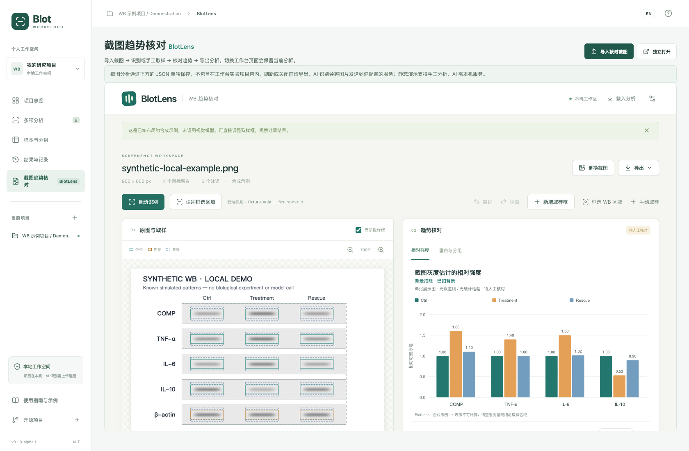

# BlotLens 与工作台

BlotLens 是独立公开 MIT 仓库：https://github.com/Gaoyuan-0423/blotlens 。`reviewer` 是固定提交的 Git 子模块，不在工作台维护另一份测量代码。更新时进入子模块选择经过验证的提交，再提交工作台的 gitlink 更新。



截图为本机 Chrome、1680×1100 视口下的合成示例；`fixture-only` 是测试配置，没有调用外部模型。

## 启动与构建

```sh
git submodule update --init --recursive
npm ci
npm run dev
```

工作台地址为 http://127.0.0.1:4316 。`WORKBENCH_PORT` 可覆盖端口。`npm run build` 构建两边并将独立页面复制到 `dist/blotlens`；`npm start` 提供同源本机 API 和生产页面。`npm run preview` 仅预览静态文件，不能调用模型。`npm run reviewer:dev` 单独运行 BlotLens，默认端口 4317。

源码下载 ZIP 不自动包含子模块内容，建议使用递归 Git 克隆。CI 同样递归检出固定提交；不会在启动时自动追踪 BlotLens 最新主线。

## 页面内的流程

侧栏或项目总览点击「截图趋势核对」，选择「导入核对截图」，随后在内嵌页面识别、人工修正、检查趋势和导出。PNG/JPEG 按原始文件字节传入，不截图或重新压缩，不会因为导入而自动请求 AI。也可直接在内嵌页面粘贴、拖入或载入 JSON。

模块保持挂载，切换回项目总览或样本页不会清空取样框。若已有截图，关闭或刷新工作台前浏览器会提示未保存分析（是否显示受浏览器规则影响）。保存使用 BlotLens 的可复算 JSON；它不在工作台 `.wbproj.zip` 项目包中，也不自动计入生物学重复数。

## 接口与隐私

iframe 与宿主同源，双向消息限定 origin、source 和协议版本。子模块校验文件类型、大小、解码尺寸及哈希。宿主重用 BlotLens 本机服务，仅监听 127.0.0.1，沿用 Host 和 Origin 检查；不开放跨域 API。API Key 只保留在这一服务进程内存中；独立 4317 和工作台 4316 的设置不会互相同步。

静态部署支持本地人工测量、示例和导出；AI 需要本机服务。用户点击识别时，图片或选区才发送到明确配置的供应商。工作台原实验项目演示的浏览器持久化不适用于截图分析。

## 本次集成验证（2026-10-11）

- 固定 BlotLens 提交 `b20ec340701ca35a33956c9e2ed1590ea7cedaf3`。独立仓库 [CI](https://github.com/Gaoyuan-0423/blotlens/actions/runs/38072903250) 已通过；本机 128 项单元测试、37 项浏览器测试通过。两张用户示例仅在本机以固定模型响应验收，未上传仓库，也不代表真实模型识别准确率。
- 工作台 18 项核心测试、13 项脚本测试、9 项 Chrome 浏览器测试通过。新增覆盖宿主原图导入、不自动调用模型、非法类型与非父窗口消息拒绝、切页保留分析、JSON 导出及恢复、原实验项目不受影响。
- 开发服务 4316 和生产服务 4326 均完成内嵌合成示例检查，15 行测量结果、无页面异常。生产服务确认同源 API 设置可用，错误 Origin 返回 403，配置读取不返回密钥；未调用模型。
- 构建同时产出工作台与相对路径的 BlotLens 静态页面。浏览器测试使用 `WB_TEST_PORT=4175 BROWSER_CHANNEL=chrome npm run test:e2e`，明确启动当前构建，避免复用其他目录旧预览服务。

以上检查验证集成与可复算流程，不验证截图测量的生物学准确性或模型的泛化能力。
