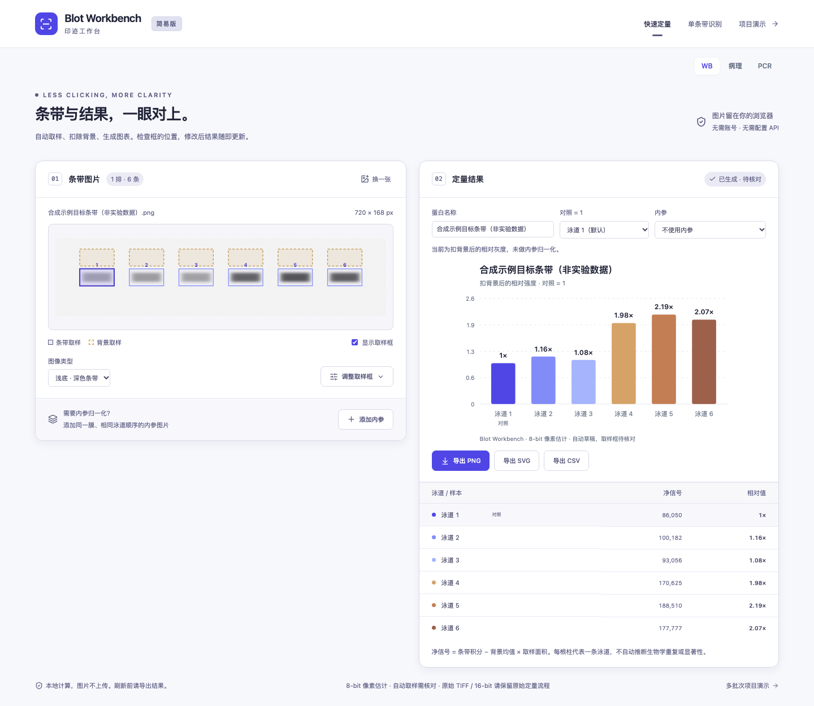

# 简易版：导入后直接看结果

多排 / 内参分析入口为 `?mode=quick`。只分析一张单排图时，可用更精简的[单条带识别栏目](single-strip.md)（`?mode=single`）。首页 `/` 提供各工作区入口；原项目演示在 `#demo`，完整分析在 `#real`。将一张 WB 条带图拖入、粘贴或点击导入，页面自动生成取样框、背景框、相对强度柱状图和数值表；图片与结果并排展示。第一次使用可以点击“试用示例”，查看六条合成条带的完整流程。

## 支持的图片

- 优先使用裁好的一排条带，保留条带上下及两侧的空白背景。
- 多排膜图会尝试自动分行。点击“第 1 排”“第 2 排”等切换目标蛋白；行数和泳道数需要核对，文字、边框和弱条带可能影响识别。
- 当前支持 **8-bit PNG / JPEG**，每张不超过 15 MB。TIFF 和 16-bit 原图不在此版本支持范围内。截图、JPEG 压缩和导出转换都可能改变像素，原始图像应另行保存。
- 深色条带使用默认的“浅底 · 深色条带”；浅色条带可改为“深底 · 浅色条带”。

图片在当前浏览器中读取、计算，不上传到服务器，无需账号或 API。简易分析不自动保存；刷新或关闭前请导出所需结果。

## 查看和调整

导入后先核对泳道数量、靛蓝条带框及虚线背景框。需要修改时点击“调整取样框”：可以按指定泳道数重新取样，拖动靛蓝框，使用方向键移动一个像素，或输入框的坐标与尺寸。条带框和背景框均可调整，修改后立即重新计算。手动指定数量采用等宽分配，仍需检查是否对齐。

默认以第一条泳道为对照（相对值为 1），可在“对照泳道”中更换。蛋白名称和各泳道名称可直接编辑。每根柱代表一条泳道；页面不自动指定实验组、生物学重复、误差线或显著性。

## 内参与计算方法

不选内参时，显示各泳道扣背景后的净信号相对于所选对照的倍数：

`净信号 = 条带积分 − 背景框的平均信号 × 条带框面积`

`相对值 = 本泳道净信号 / 对照泳道净信号`

同一张多排图可在“内参条带”中选择另一排，也可通过“添加内参”导入单独的图片。目标与内参按从左到右的泳道顺序配对，必须自行核对样本对应关系。使用内参时，先计算每条泳道的“目标净信号 / 内参净信号”，再相对于对照计算倍数。目标和内参的泳道数量不一致时，不生成归一化相对值。

外部内参可点击“调整内参取样”查看并编辑取样框；右侧仍显示目标蛋白的归一化结果。点击“返回目标条带”回到目标图。内参的框、背景和极性也会记录到 CSV。

无清晰条带、背景无效、框重叠或扣背景后信号不大于零时，不会补造结果；无法计算的值显示为“—”，并提供调整提示。没有有效相对值时，图表导出不可用。

## 导出与使用边界

“导出 PNG / SVG”保存当前图表；“导出 CSV”保存当前所选蛋白行的原始积分、背景扣除量、净信号、内参、对照、相对值、取样坐标和计算方法。多排行需要分别选择、分别导出。CSV 使用 `UNREVIEWED_PIXEL_ESTIMATE` 标记结果，保留无效值为空以及相关说明。

这些结果是 **尚未经真实实验图像验证的 8-bit 像素估计**。自动取样是待核对的初稿，不能证明曝光在线性范围内、跨膜可比或已经完成科研定量验证。“试用示例”和自动化测试使用合成像素，只用于检查计算和操作流程，不代表真实 WB 图像的识别准确率。完整的多批次预置流程仍可从“项目演示”进入，与简易版的即时像素测量分开使用。

## 验证范围

快速分析已集成到主线测试流程。合成像素与浏览器测试覆盖格式限制、ROI、背景扣除、独立内参极性、归一化、导出和布局；这些检查不代表真实实验图像识别准确率。版本验证见 [界面与快速入口更新](releases/ui-refresh-2026-10-16.md)。

下图来自本机浏览器测试，画面为合成示例。

