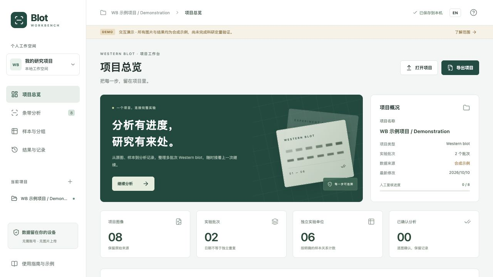
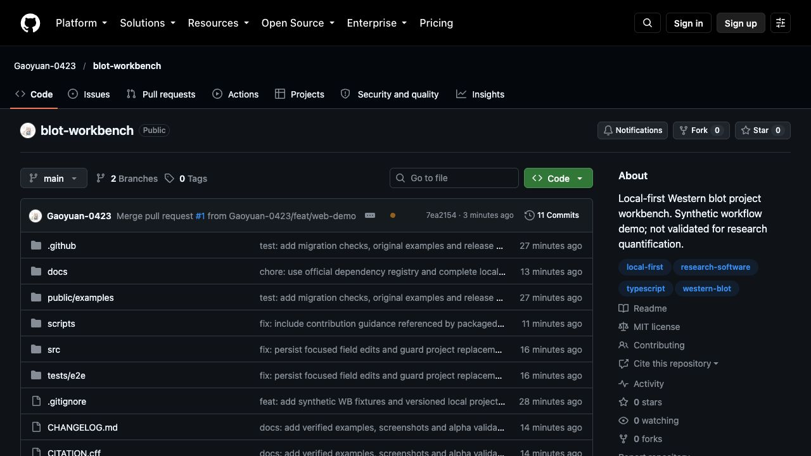

# 截图与版本证据 / Screenshot provenance

此目录用于保存实际运行截图。不得用设计稿、竞品界面或拼接图冒充本项目运行结果；截图也不代替功能测试。

| 文件 | 内容 | 证据元数据 |
| --- | --- | --- |
| `app-home.jpg` | 本项目本地网页演示首页，实际 CUA 全页截图 | 2026-10-10；`0.1.0-alpha.1`；1440 × 1483 像素；应用源码及采集环境见下文 |
| `app-analysis.jpg` | 本项目本地条带分析页，实际 CUA 全页截图 | 2026-10-10；`0.1.0-alpha.1`；1440 × 1533 像素；应用源码及采集环境见下文 |
| `repository-home.jpg` | 公开 GitHub 仓库首页，实际 CUA 视窗截图 | 2026-10-10；1280 × 720；main 提交 `7ea2154`；预发布创建前 |
| `deployed-home.jpg` | 已上线 Pages 首页，实际 CUA 视窗截图 | 2026-10-10；`0.1.0-alpha.1`；1280 × 720；部署提交 `7ea2154` |
| `vision-api-settings.jpg` | 本机 API 设置开发页，未配置、未调用模型 | 2026-10-11；`0.2.0-dev.1`；1280 × 720；源码为该文件首次加入的 Git 提交，详见[验证记录](../validation-vision-api.md) |
| `user-guide-zh.jpg` / `user-guide-en.jpg` | 同一独立教程页切换中文与英文的实际截图 / Actual Chinese and English views of the same guide | 2026-10-11；`0.2.0-dev.1`；1265 × 712；Codex in-app Chromium；`http://127.0.0.1:5318/#guide`；源码为文件首次加入的 Git 提交 |

教程截图使用默认视窗，未后处理；项目名保留合成示例自身的中英名称，教程正文和控件跟随界面语言。采集地址使用独立测试端口，没有更改用户在 4318 端口上的项目或 API 设置。 / The guide captures use the default viewport and are unedited. The synthetic project's own bilingual name is retained, while guide text and controls follow the interface language. A separate test port preserves the user's project and API settings on port 4318.

教程改动的本机检查：36 项核心/服务测试及构建通过，Chrome 原有 7 项工作流测试通过；实际浏览器检查了中英完整正文、`#guide` 刷新恢复、载入示例保留英文、进入样本/API 页面及展开 FAQ。此记录不是科研定量验证。 / Local checks for the guide change passed 36 core/server tests, the build, and 7 existing Chrome workflow tests. Manual browser checks covered both languages, refreshing `#guide`, retaining English after loading the example, opening Samples/API settings, and expanding FAQs. These checks do not validate scientific quantification.

两张应用截图于 **2026-10-10（Asia/Shanghai）** 从 macOS 27.0.1 上运行的本地应用采集，使用 Codex in-app Chromium 的 CUA 截图能力。应用源码与 [`729a3ecc2576e9fae7d0af407fadb2632b76e87f`](https://github.com/Gaoyuan-0423/blot-workbench/commit/729a3ecc2576e9fae7d0af407fadb2632b76e87f) 一致；文档与截图文件在后续提交归档不改变这个应用源码对应关系。

视窗设置为 **1440 × 1000**，采集时页面已有 **110% zoom**，有效 CSS 宽度约 **1309 px**。使用全页捕获，因此图片高度大于视窗高度。图片未经后处理，没有裁剪、重绘、拼接或叠加元素；文件为实际捕获的 JPEG。

来源为本机预览页面 `http://127.0.0.1:4173/`，不是已部署站点。Codex in-app Chromium 的宿主版本未单独记录，不能以 E2E 测试使用的 Chrome/Edge 版本替代。E2E 环境及结果另见[验证记录](../validation.md)。

仓库截图来源为 [GitHub 仓库](https://github.com/Gaoyuan-0423/blot-workbench)，可见 main 提交为 `7ea215419f51df283962d62b8ead768a6758caba`。截图采集于预发布创建前，其中数量只代表当时状态。上线截图来源为 [GitHub Pages](https://gaoyuan-0423.github.io/blot-workbench/)，对应同一完整提交及 [部署运行](https://github.com/Gaoyuan-0423/blot-workbench/actions/runs/38061081294)。这两张图使用 Codex in-app Chromium 默认视窗，macOS 27.0.1，宿主浏览器版本未单独记录；均未后处理。

应用与仓库截图都必须在相应页面实际运行后采集。不得创建虚假 GitHub 仓库截图，也不以拟用地址代替已经存在的仓库。

English: both application images are unedited full-page CUA captures from Codex in-app Chromium on macOS 27.0.1, captured on 2026-10-10 for app version `0.1.0-alpha.1` and source commit `729a3ecc2576e9fae7d0af407fadb2632b76e87f`, at local URL `http://127.0.0.1:4173/`. The configured viewport was 1440 × 1000 at an existing 110% page zoom (about 1309 CSS pixels wide); full-page JPEG dimensions are listed above. No image post-processing was applied. The in-app Chromium host version was not recorded; do not substitute the independently tested Chrome/Edge versions. The repository and deployed-home viewport captures were taken on 2026-10-10 at 1280 × 720 and commit `7ea215419f51df283962d62b8ead768a6758caba`, before the prerelease was created; their URLs and deployment evidence are listed above. Screenshots do not establish quantitative accuracy or platform coverage.
