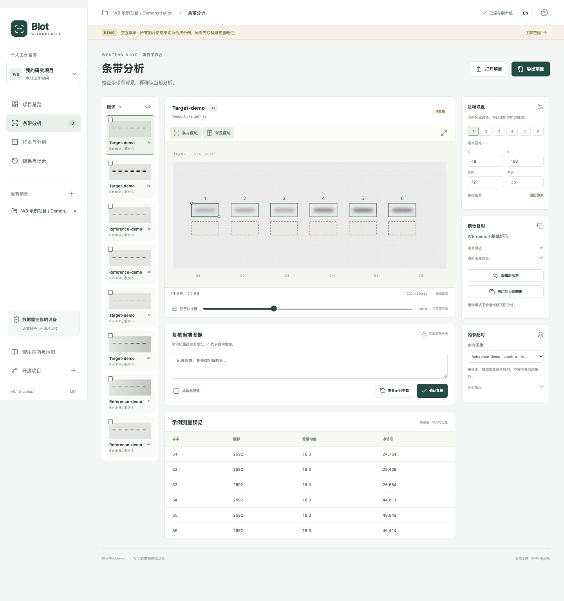

# 截图与版本证据 / Screenshot provenance

此目录用于保存实际运行截图。不得用设计稿、竞品界面或拼接图冒充本项目运行结果；截图也不代替功能测试。

| 文件 | 内容 | 证据元数据 |
| --- | --- | --- |
| `app-home.jpg` | 本项目本地网页演示首页，实际 CUA 全页截图 | 2026-10-10；`0.1.0-alpha.1`；1440 × 1483 像素；应用源码及采集环境见下文 |
| `app-analysis.jpg` | 本项目本地条带分析页，实际 CUA 全页截图 | 2026-10-10；`0.1.0-alpha.1`；1440 × 1533 像素；应用源码及采集环境见下文 |
| `repository-home.jpg` | 已建立仓库的首页，待实际 CUA 截图文件归档 | 待记录实际地址、采集时间、可见分支/commit 和浏览器版本 |

两张应用截图于 **2026-10-10（Asia/Shanghai）** 从 macOS 27.0.1 上运行的本地应用采集，使用 Codex in-app Chromium 的 CUA 截图能力。应用源码与 [`729a3ecc2576e9fae7d0af407fadb2632b76e87f`](https://github.com/Gaoyuan-0423/blot-workbench/commit/729a3ecc2576e9fae7d0af407fadb2632b76e87f) 一致；文档与截图文件在后续提交归档不改变这个应用源码对应关系。

视窗设置为 **1440 × 1000**，采集时页面已有 **110% zoom**，有效 CSS 宽度约 **1309 px**。使用全页捕获，因此图片高度大于视窗高度。图片未经后处理，没有裁剪、重绘、拼接或叠加元素；文件为实际捕获的 JPEG。

来源为本机预览页面 `http://127.0.0.1:4173/`，不是已部署站点。Codex in-app Chromium 的宿主版本未单独记录，不能以 E2E 测试使用的 Chrome/Edge 版本替代。E2E 环境及结果另见[验证记录](../validation.md)。

只有对应文件实际生成并检查后，才能将其视为已提供。仓库截图的待补项不代表已截图；应用截图本身也不代表应用已上线或算法通过科研验证。

应用与仓库截图都必须在相应页面实际运行后采集。不得创建虚假 GitHub 仓库截图，也不以拟用地址代替已经存在的仓库。

English: both application images are unedited full-page CUA captures from Codex in-app Chromium on macOS 27.0.1, captured on 2026-10-10 for app version `0.1.0-alpha.1` and source commit `729a3ecc2576e9fae7d0af407fadb2632b76e87f`, at local URL `http://127.0.0.1:4173/`. The configured viewport was 1440 × 1000 at an existing 110% page zoom (about 1309 CSS pixels wide); full-page JPEG dimensions are listed above. No image post-processing was applied. The in-app Chromium host version was not recorded; do not substitute the independently tested Chrome/Edge versions. Repository capture metadata remains pending. Screenshots do not establish quantitative accuracy or platform coverage.
