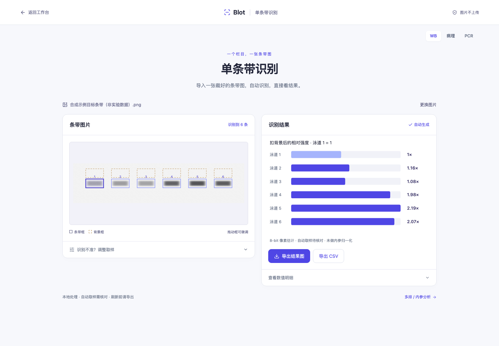

# 单条带识别 / Single-strip recognition

入口 / Entry: `?mode=single`。网站首页优先提供这个栏目。多排与内参分析位于 `?mode=quick`；需要原始 TIFF/PNG、实验配对与统计的进阶项目位于 `#real`；合成演示位于 `#demo`（兼容 `?mode=project`）。

The homepage prioritizes this independent workflow. Use `?mode=quick` for multiple rows and reference normalization, `#real` for advanced original-image projects and statistics, and `#demo` for the synthetic demonstration (`?mode=project` remains compatible).

## 中文说明

### 导入后直接看结果

1. 导入、拖入或粘贴条带图片。支持 **单页 8/16-bit 无符号整数 TIFF**（64 MB、8388608 像素）和 **8-bit PNG/JPEG**（15 MB、2000 万像素），单边最大 16000 像素。BigTIFF、多页 TIFF、高位深 PNG 和部分带旋转/翻转 EXIF 信息的 JPEG 会明确拒绝。
2. 单排图自动判断深浅背景、识别泳道、扣背景，并在图像旁显示相对强度。默认以泳道 1 为对照。先核对条带框和背景框，不能把自动候选直接当作正确答案。
3. 遇到倾斜或多排图，使用图片上方的“拉直条带”和“圈出一排”。准备完成后会自动重新识别。
4. 仍需修改时，展开“识别不准？调整取样”，调整泳道数、深浅色模式、对照及框坐标，也可以拖动框或用方向键微调。最后导出当前曝光图的结果 PNG 或 CSV。

### 整体倾斜、弯曲与裁剪

- **整体倾斜：**选择“拉直条带 → 整体倾斜”，在原图同一排条带的中心线左右两端各点一下，再点“应用校直”。两个点应覆盖这排条带的主要横向范围。
- **弯曲校直：**选择“弯曲校直”，沿同一排条带中心线从左到右点 **3–8 个点**，再应用。点需要沿不同列分开；不要把不同蛋白行的点连成一条线。此功能依据用户选择的基线进行分段校直，不自动判定生物学上对应哪一条带。
- **圈出一排：**在当前校直后的图片上拖出矩形，保留上下及左右足够空白作背景，然后点“应用裁剪”。选区至少 8 × 8 像素。多排图片不会悄悄选其中一排，需用户明确选择。
- 建议先校直，再裁剪，最后微调取样框。重新校直会重置此前裁剪和取样框；应用校直或裁剪会重新识别并把对照恢复为泳道 1，需要再次核对。
- “查看原图”用于比较原始显示；“恢复完整原图”移除几何准备并重新识别。旋转/弯曲后产生的边缘空白不是有效测量像素，条带或背景框覆盖这些区域时会提示调整。

### 显示调整与多曝光选择

“显示调整”提供亮度和对比度，并可恢复默认显示。它们**只改变屏幕显示，不改变识别输入或定量值**。把过曝图片调暗并不能恢复已经饱和的原始信号；仍需查看真实曝光图和质量提示。

可以一次选择多张曝光图，或使用“添加曝光图”。当前最多保留 **6 张**，合计不超过 **3000 万像素**。点击缩略图切换，每张图分别保留校直、裁剪、取样框、对照、图像类型与显示设置。结果和导出始终对应当前选中的图片。

这里提供的是人工比较与选择，没有自动判断“最佳曝光”，也不会混合像素、拼接不同曝光的泳道、合并结果或自动除以曝光时长。同一样本的多次曝光不增加生物学重复数。应为同一比较选择合适且一致的曝光条件，并检查是否饱和。

### 测量与 CSV 的含义

TIFF 通过整数图像解码器读取，保留 **8/16-bit 原始强度**；RGB 使用 `(R+G+B)/3`，不将测量数组量化为 8-bit。TIFF 的屏幕预览单独线性映射到 8-bit。PNG/JPEG 延续浏览器解码的 **8-bit 灰度数组**，按 `round(0.299 R + 0.587 G + 0.114 B)` 转灰度，透明部分以白色背景显示。JPEG 压缩及先前图像处理丢失的信息不会恢复。

校直后的预览用于显示和候选识别。定量仍读取源灰度数组：把每个原始像素中心 `(x + 0.5, y + 0.5)` 通过“旋转 → 弯曲列位移 → 裁剪”的几何映射定位，按其是否落在当前条带/背景矩形内累积，每个源像素在同一取样框内最多计一次。不会把旋转预览的插值或填充像素当作新测量。几何边界会改变框内实际源像素集合，因此实际面积可能不同于预览矩形的宽乘高。

深色条带的净信号等价于 `源条带像素数 × 源背景均值 − 源条带灰度和`；浅色条带反号。相对值是当前曝光内各泳道的净信号除以所选对照净信号。本栏目不做内参归一化或统计检验；无有效背景、非正净信号或不合格取样时，不补造相对值。

CSV 除取样坐标和信号外，还记录：

| 字段 | 含义 |
| --- | --- |
| `coordinate_space` | 未准备图为 `source_pixels`；校直/裁剪后为 `prepared_pixels`。ROI 坐标据此解释。 |
| `source_width`, `source_height` | 源图尺寸。 |
| `preparation` | JSON，含 `single-preparation-v1`、`original-8-bit-pixel-centers` 或 `original-16-bit-pixel-centers`、校直点、弯曲基线、旋转参数、变换顺序与裁剪范围。 |
| `source_pixel_area`, `background_source_pixel_area` | 此条带和背景实际使用的源像素数。 |
| `exposure_id` | 浏览器内区分当前图片的标识，不是仪器曝光时长。 |

PNG 图中会显示源文件名及曝光 ID 前缀；PNG/CSV 文件名也含同样标识。同名曝光图仍可区分。导出前请核对当前图片名称、对照和提示。CSV 保存参数和结果，不内嵌源图；应另行保留输入图片。

### 保存与验证边界

图片在浏览器内处理；当前单条带会话不自动持久保存，刷新或离开前请通过“本地项目”下载可恢复项目包。项目包保留 TIFF 原文件、原始位深测量值、取样框和准备设置；新 TIFF 项目需要支持 TIFF 的版本打开，旧 PNG/JPEG 项目仍可导入。切换中英文不会重置当前分析。

新增校直、裁剪、显示分离和曝光独立性主要通过合成像素与端到端交互测试验证。这能检查实现是否按预期工作，不能据此宣称真实实验的自动识别准确率、跨仪器稳健性或优于 ImageJ。既有 `src/real` 的真实图片参考回归覆盖其解码和测量路径，不能代替本栏目新几何流程的真实图像验证。真实应用仍需逐图复核取样和曝光条件。

## English guide

### Import and inspect

1. Import, drop, or paste a **single-page unsigned 8/16-bit TIFF** (64 MB / 8,388,608 pixels) or **8-bit PNG/JPEG** (15 MB / 20 million pixels). No side may exceed 16,000 pixels. BigTIFF, multipage TIFF, high-bit-depth PNG, and some JPEGs with rotation/mirroring EXIF orientation are rejected explicitly.
2. A single row is detected automatically, with background correction and relative intensity shown beside the image. Lane 1 is the default control. Inspect the band and background boxes before using the results.
3. For tilted or multirow images, use **Straighten strip** and **Select one row** above the image. Applying either operation triggers recognition again.
4. Expand the sampling adjustments when needed to change lane count, polarity, control, or coordinates. Dragging and arrow keys can refine boxes. Export the current exposure's result chart as PNG or its results as CSV.

### Straightening and cropping

- **Overall tilt:** choose **Straighten strip → Overall tilt**, mark two points at the left and right ends of the center line of one band row on the original image, then apply.
- **Curved strip:** mark **3–8 points** from left to right along the same row's center line. Points must occupy separated columns. Do not join points from different protein rows. Correction follows the user-defined baseline; it does not determine biological band identity.
- **Select one row:** drag a rectangle on the current corrected view, retain clear background around the row, and apply the crop. The selection must be at least 8 × 8 pixels. Multiple rows require an explicit selection.
- Straighten first, crop next, and refine sampling boxes last. Reapplying straightening resets the previous crop and regions. Applying straightening or cropping re-detects bands and resets the control to lane 1; review again.
- **View original** allows a visual comparison. **Restore full original** removes geometric preparation and re-detects bands. Blank borders introduced by correction are not measurement pixels; boxes covering these areas must be adjusted.

### Display adjustments and exposures

Brightness and contrast change **display only**. They do not change detection input or measurement values, and dimming cannot recover saturated source signals.

Import several exposures together or choose **Add exposure**. Up to **six images**, totaling no more than **30 million pixels**, can be retained. Each exposure keeps its own geometric preparation, regions, control, polarity, and display settings. Results and exports always belong to the selected image.

Selection is manual. The tool does not choose a scientifically optimal exposure, combine pixels, splice lanes from different exposures, merge measurements, or normalize by exposure time. Additional exposures of the same sample are not additional biological replicates. Review saturation and use appropriate, consistent acquisition conditions for comparisons.

### Quantification and export metadata

TIFF uses the integer decoder and retains **original 8/16-bit intensities**, with `(R+G+B)/3` for RGB. Its separate display preview is mapped linearly to 8-bit; measurement values are not quantized. PNG/JPEG keep their browser-decoded **8-bit grayscale array** using `round(0.299 R + 0.587 G + 0.114 B)` and white transparency compositing. Previously lost or compressed signal cannot be recovered.

The corrected preview supports display and detection. Quantification maps each source pixel center `(x + 0.5, y + 0.5)` through **rotation → column shift for curvature → crop**, then accumulates the source values whose centers fall within each band/background rectangle. Each source pixel contributes at most once per region. Interpolated preview pixels and border padding are not measured. The actual source-pixel area can differ from the displayed rectangle's width times height.

For dark bands, net signal equals source band area × source background mean − source band grayscale sum; the sign reverses for light bands. Relative intensity divides each valid net signal by the selected control's net signal within the current exposure. This workflow does not perform reference-protein normalization or statistical tests. Invalid sampling, unavailable background, or nonpositive net signal does not produce a fabricated relative value.

CSV includes `coordinate_space` (`source_pixels` or `prepared_pixels`), source dimensions, actual band/background source-pixel areas, `exposure_id`, and a `preparation` JSON object. The JSON records `single-preparation-v1`, `original-8-bit-pixel-centers` or `original-16-bit-pixel-centers`, baseline points, rotation, transformation order, and crop geometry. ROI coordinates refer to the declared coordinate space. The exposure ID distinguishes images in the session; it is not an acquisition duration. PNG charts include the source filename and an exposure ID prefix; PNG/CSV download names also carry these identifiers to distinguish exposures with identical names. Keep the input images separately because CSV does not embed them.

### Persistence and validation limits

Processing stays in the browser. The single-strip session is not automatically persisted; download a recoverable archive through **Local project** before refreshing or leaving. Archives retain TIFF originals, original-depth measurement arrays, regions and preparation settings. New TIFF projects require a TIFF-capable version; older PNG/JPEG projects remain importable. Language switching retains the analysis.

Synthetic-pixel and end-to-end tests cover the new geometry, cropping, separation of display from measurements, and exposure independence. These checks do not establish real-experiment detection accuracy, robustness across instruments, or superiority to ImageJ. The existing real-image reference regression covers the separate `src/real` decoding/measurement engine and does not substitute for real-image validation of this new geometric workflow. Review each image's sampling and acquisition conditions.

